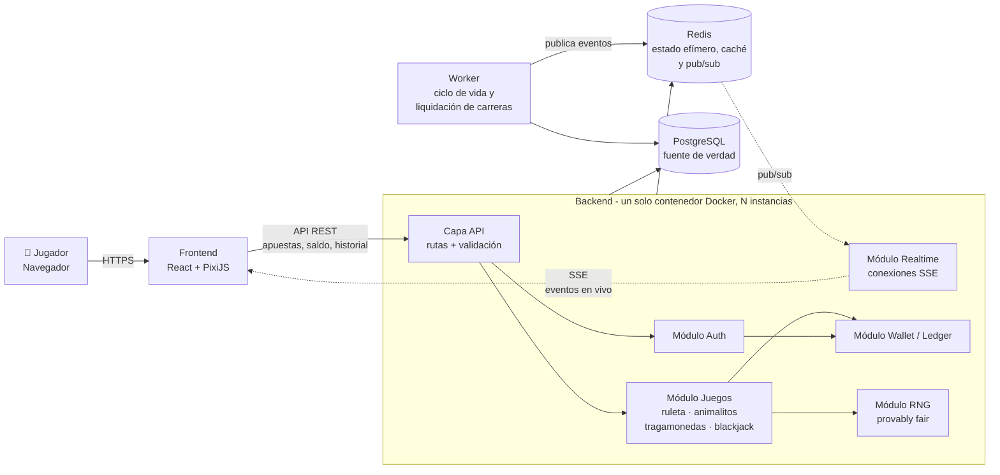
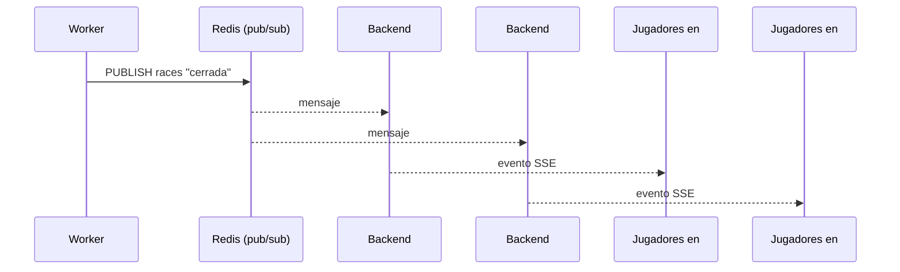
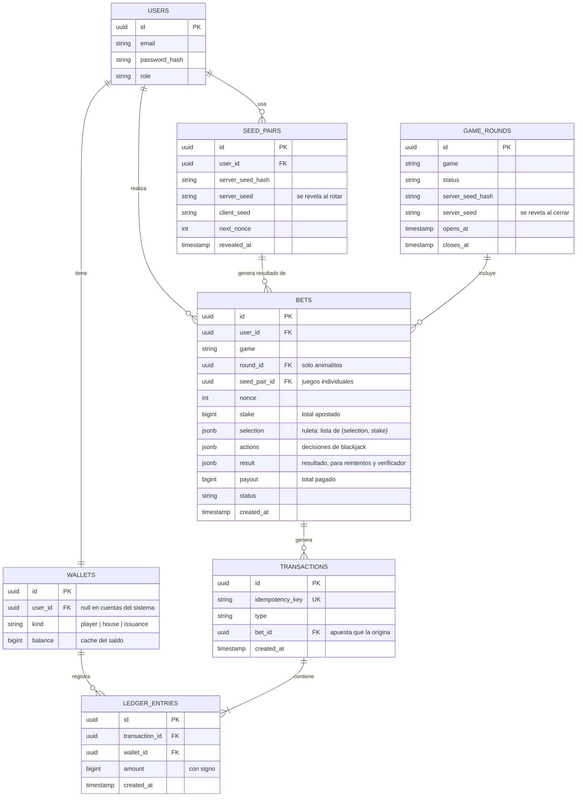
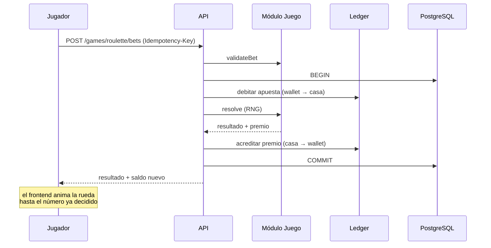
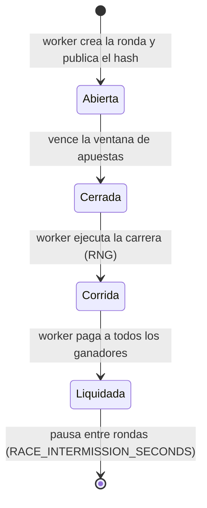
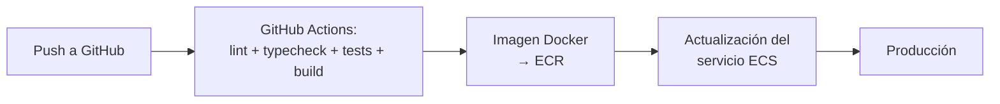

# 🎰 Casino Cloud

Plataforma web de casino con **dinero ficticio**, diseñada como proyecto integrador de *Computación en la Nube* (INFO-02028, UCAB).
## Equipo : Sebastian Vera, Claudia Lopez, Santiago de Andrade, Juan Sebastian Zamora, Juan Quintana.
 


> ⚠️ **Aviso:** este proyecto es académico. No procesa dinero real ni criptomonedas reales. Todos los saldos son una moneda ficticia (créditos) y no tienen valor monetario. El dominio funcional fue presentado al profesor para su aprobación, según la sección 1 de la guía del proyecto.

El objetivo no es el casino en sí, sino demostrar cómo diseñar, desplegar y operar una aplicación **nativa de la nube**: contenedores, base de datos administrada, caché, tiempo real, CI/CD, secretos, observabilidad y escalabilidad. Los juegos son el pretexto; lo que importa es lo que hay debajo.

---

## 1. Qué hace la aplicación

Un jugador puede:

1. Registrarse e iniciar sesión.
2. Recibir créditos ficticios mediante un depósito simulado.
3. Apostar en distintos juegos usando esos créditos.
4. Ver el resultado, su saldo actualizado y su historial de apuestas.
5. Seguir en vivo las carreras de animalitos (cuenta regresiva, carrera y resultado).
6. Verificar en el propio navegador que cada resultado fue justo (sistema *provably fair*, ver sección 5).

### Juegos y prioridad

La guía del proyecto establece que la complejidad funcional no es el criterio principal. Por eso el alcance se ordena por **valor arquitectónico**, no por cantidad de juegos:

| Prioridad | Juego | Tipo | Por qué es interesante arquitectónicamente |
|---|---|---|---|
| **Núcleo** | **Ruleta** | Una apuesta → un resultado inmediato | Sin estado entre apuestas. Es el caso más simple y escala fácil. |
| **Núcleo** | **Carreras de animalitos** | Evento compartido entre muchos jugadores | Ventana de apuestas, tiempo real, cierre, carrera y liquidación masiva. Es el juego más exigente en concurrencia. |
| Extra | **Minijuegos**: Cruza la Calle, Dino Crash y Despegue | Cruza la Calle: partida por pasos (con estado). Dino Crash y Despegue: ronda compartida en vivo | Reutilizan los dos patrones del núcleo sin tablas nuevas: Cruza la Calle guarda la partida entre pasos como el blackjack (4.4), y los dos Crash usan rondas, worker y SSE como los animalitos (4.3). Reemplazan a las tragamonedas. |
| Opcional | **Blackjack** | Partida con estado (mano en curso) | Requiere guardar la sesión de juego entre decisiones del jugador. Solo si el núcleo está terminado. |

La arquitectura se diseña y se defiende sobre **ruleta** (patrón sin estado) y **animalitos** (patrón de evento compartido en tiempo real). Los demás juegos reutilizan la misma base.

**Fuera de alcance:** apuestas deportivas en vivo, criptomonedas reales, pagos con dinero real, verificación de identidad (KYC).

---

## 2. Arquitectura del software

### 2.1 Visión general

Es un **monolito modular**: un solo backend desplegable, dividido internamente en módulos con responsabilidades claras. Se eligió así (y no microservicios) porque el volumen esperado no lo justifica y porque las operaciones con dinero necesitan **transacciones atómicas** en una sola base de datos, algo que se complica mucho con servicios distribuidos.



### 2.2 Capas

| Capa | Responsabilidad |
|---|---|
| **Frontend** | Interfaz del jugador. No contiene lógica de dinero ni de resultados: muestra, envía solicitudes y anima resultados que ya decidió el servidor. |
| **Backend / API** | Valida solicitudes, autentica, ejecuta la lógica de juego y de dinero. Toda decisión importante ocurre aquí, nunca en el cliente. |
| **Tiempo real** | El backend mantiene conexiones SSE con los clientes y les reenvía los eventos de las carreras (ver 2.5). |
| **Persistencia** | PostgreSQL: usuarios, ledger, apuestas, rondas. Es la única fuente de verdad del dinero. |
| **Caché / estado efímero** | Redis: ventanas de apuesta, caché de la mano de blackjack, caché de configuración, límites de tasa y canal pub/sub de eventos. |
| **Worker** | Proceso aparte que abre, cierra, corre y liquida las carreras, y publica cada cambio de estado. |
| **Servicios externos** | Ninguno obligatorio. El depósito es simulado detrás de un adaptador de pagos (ver 2.4). |

### 2.3 Módulos del backend

- **Auth:** registro, login, sesiones/tokens, roles (jugador, administrador).
- **Wallet / Ledger:** el corazón del sistema. Maneja saldos y movimientos de dinero (ver sección 3).
- **Juegos:** cada juego implementa una interfaz común (ver sección 4).
- **RNG:** genera resultados aleatorios verificables (ver sección 5).
- **Realtime:** gestiona las conexiones SSE y se suscribe a los eventos publicados en Redis.
- **Pagos (adaptador):** interfaz `PaymentProvider` con una implementación simulada. Si algún día se quisiera integrar otro método de pago, solo se cambia el adaptador.
- **Admin:** consulta de jugadores, rondas y auditoría del ledger.

Regla de diseño: **los juegos nunca modifican saldos directamente**. Siempre piden al módulo Wallet que registre un movimiento.

### 2.4 Adaptador de pagos

El depósito y el retiro pasan por una interfaz única. Hoy hay una implementación simulada que acredita créditos de prueba desde la cuenta de emisión del sistema (ver 3.1). Esto permite explicar en la defensa cómo se aislaría un proveedor externo sin tocar el resto del sistema.

### 2.5 Tiempo real

Las carreras de animalitos son un evento compartido: todos los jugadores deben ver la misma cuenta regresiva, la misma carrera y el mismo resultado al mismo tiempo. Consultar la API cada segundo (*polling*) multiplicaría la carga por el número de jugadores conectados, así que el servidor **empuja** los eventos.

**Decisión: Server-Sent Events (SSE) en lugar de WebSockets.**

- El flujo en vivo es **unidireccional** (servidor → cliente). El jugador nunca necesita enviar nada por ese canal.
- Las apuestas siguen entrando por **REST**, donde ya están resueltas la autenticación, la validación y la idempotencia (sección 3.3). Mover las apuestas a un socket obligaría a reimplementar todo eso.
- SSE es HTTP normal: atraviesa balanceadores y proxies sin configuración especial.
- El cliente consume el flujo con `fetch` y la cabecera `Authorization: Bearer`, en lugar de `EventSource`, porque `EventSource` no permite enviar cabeceras y el canal exige el mismo token que la API (sección 8). Como `EventSource` no se usa, la **reconexión la implementa el propio cliente**, con espera creciente entre intentos.
- Si en el futuro se necesitara comunicación bidireccional (por ejemplo, un chat), se cambiaría a WebSockets sin tocar el resto del diseño.

**Problema con varias instancias del backend:** cada jugador está conectado a *una* instancia, pero el evento lo genera el worker, que no sabe qué instancia tiene a quién. La solución es **Redis pub/sub**:



Todos los eventos viajan por **un único canal de Redis, `races`**: solo hay una ronda activa a la vez, así que no hace falta un canal por ronda; cada evento lleva el identificador de su ronda. Eventos publicados por ronda: `abierta` (con `closes_at` y el hash de la semilla), `cerrada`, `resultado` (con el animal ganador y la semilla revelada) y `liquidada`.

**Reconexión:** los eventos de SSE no son la fuente de verdad. El cliente reconecta por sí mismo cuando se corta el flujo y, **en cada conexión** (la primera incluida), vuelve a pedir el estado actual de la ronda por REST (`GET /races/current`) y luego sigue escuchando. Además, si una fase se alarga más de lo esperado (por ejemplo, una ronda abierta pasa 2 segundos de su `closes_at` sin que llegue el evento `cerrada`), el cliente vuelve a consultar `GET /races/current`, y lo repite cada 5 segundos mientras siga atrasado. Si se pierde un evento, no se pierde nada importante.

**Consecuencia para el diseño:** el backend sigue sin guardar estado de negocio, pero las conexiones SSE abiertas sí son un estado en memoria. Si una instancia cae, sus clientes reconectan a otra y recuperan el estado por REST. Ver sección 6.

---

## 3. Wallet y Ledger (la parte crítica)

Cualquier sistema que mueve dinero necesita garantías fuertes, aunque el dinero sea ficticio. Estas son las reglas que el proyecto cumple:

### 3.1 Ledger de doble entrada

Cada movimiento de dinero es una **transacción** formada por al menos dos **asientos** que suman cero: lo que sale de una cuenta entra en otra.

Además de los wallets de los jugadores, existen dos **cuentas del sistema**:

| Cuenta del sistema | Uso |
|---|---|
| **Emisión** | Origen de los créditos de los depósitos simulados (y destino de los retiros). Su saldo es negativo: representa todo el dinero ficticio en circulación. |
| **Casa** | Recibe las apuestas perdidas y paga los premios. |

Ejemplo, depósito simulado de 1.000 créditos:

| Cuenta | Débito | Crédito |
|---|---|---|
| Emisión | 1.000 | |
| Wallet del jugador | | 1.000 |

Ejemplo, apuesta de 100 créditos que pierde:

| Cuenta | Débito | Crédito |
|---|---|---|
| Wallet del jugador | 100 | |
| Cuenta de la casa | | 100 |

Ejemplo, la misma apuesta si gana con pago 2x (la casa devuelve 200):

| Cuenta | Débito | Crédito |
|---|---|---|
| Cuenta de la casa | 200 | |
| Wallet del jugador | | 200 |

Los asientos **nunca se editan ni se borran**. Una corrección es una nueva transacción. Así el historial es auditable y se puede comprobar en cualquier momento que **la suma de todo el sistema es cero**: lo que muestra la cuenta de emisión en negativo es exactamente lo que suman los jugadores y la casa en positivo.

### 3.2 Atomicidad

Descontar la apuesta, registrar la apuesta, calcular el resultado y acreditar el premio ocurren dentro de **una sola transacción de PostgreSQL**. O todo se guarda o nada se guarda. El saldo del jugador se bloquea durante la operación (`SELECT ... FOR UPDATE`) para evitar que dos apuestas simultáneas gasten el mismo dinero (doble gasto). Una tirada de ruleta con varias selecciones sigue siendo **una sola transacción**: se cobra el total apostado, se resuelve una única vez y se acredita el premio total; si el saldo no alcanza para el total, se rechaza la tirada completa antes de sortear.

### 3.3 Idempotencia

Cada apuesta lleva una **clave de idempotencia** única (cabecera `Idempotency-Key`). Si el cliente reintenta la misma petición por un fallo de red, el sistema devuelve el resultado original y **no cobra dos veces**. En la ruleta la clave es **una por tirada**, no una por selección: reutilizarla con una lista distinta (otra selección, otro monto u otro orden) se rechaza con `409 conflict`.

### 3.4 Modelo de datos (resumen)



Un `amount` positivo aumenta el saldo del wallet y uno negativo lo reduce; por eso la cuenta de emisión queda en negativo por diseño. La base de datos se encarga de hacer cumplir las reglas del ledger: rechaza cualquier `UPDATE` o `DELETE` sobre `ledger_entries` y `transactions`, y rechaza al hacer `COMMIT` toda transacción cuyos asientos no sumen cero o que tenga menos de dos. Una apuesta puede generar varias transacciones (la del cobro y la del premio; las carreras pagan al liquidarse), por eso la relación `BETS` a `TRANSACTIONS` es de uno a muchos. En la ruleta, una fila de `BETS` representa una **tirada**: `selection` guarda la lista de selecciones con su monto, y `stake` y `payout` son los totales de la tirada.

Los montos se guardan como **enteros** (en la unidad mínima), nunca como decimales flotantes, para evitar errores de redondeo. En el backend (TypeScript), el driver de PostgreSQL devuelve las columnas `bigint` como texto; se convierten a `BigInt` en un único punto de la capa de datos y se serializan como texto en la API, para no perder precisión ni mezclar tipos.

---

## 4. Cómo funcionan los juegos

### 4.1 Interfaz común

Todos los juegos cumplen el mismo contrato, lo que permite añadir juegos sin tocar el ledger (en la ruleta, `bet` es una sola selección con su monto; la tirada con varias selecciones se construye encima, ver 4.2):

```
Game
 ├─ validateBet(bet)     → ¿la apuesta es válida?
 ├─ resolve(bet, seed)   → calcula el resultado a partir del RNG
 └─ payout(bet, result)  → cuánto se paga (0 si pierde)
```

`resolve` es una función pura y vive en un paquete compartido (`shared/`), de modo que el **mismo código** calcula el resultado en el servidor y lo verifica en el navegador (sección 5).

### 4.2 Juegos de resultado inmediato (ruleta, tragamonedas)



Todo en una sola petición y una sola transacción. La petición de la ruleta lleva una **lista** de selecciones (`{ bets: [{ stake, selection }] }`, de 1 a 44, sin selecciones repetidas): `resolve` se ejecuta **una vez** por tirada y el `payout` de cada selección se calcula con su propio monto; el premio de la tirada es la suma. La respuesta devuelve el `payout` de cada selección en el orden enviado, más los totales `stake` y `payout`. Las reglas de la tirada (`validateSpin`, `spinPayouts`) también viven en `shared/`. No hay estado entre una apuesta y la siguiente, por eso este patrón escala simplemente añadiendo instancias del backend.

La animación es solo presentación: la rueda o los rodillos se detienen en el resultado que el servidor **ya** devolvió. El cliente nunca simula física ni calcula resultados.

### 4.3 Carreras de animalitos (evento compartido)

Una carrera es una **ronda** con ciclo de vida, controlado por el worker:



1. **Abierta:** el worker crea la ronda, guarda el hash de su semilla y publica el evento `abierta`. Los jugadores apuestan por un animal vía REST. Cada apuesta descuenta el saldo al instante (misma transacción atómica de 3.2) y queda *pendiente*. La API rechaza apuestas si `now() >= closes_at`, comprobado contra PostgreSQL; Redis solo sirve la cuenta regresiva.
2. **Cerrada:** no se aceptan más apuestas. Se publica `cerrada`.
3. **Corrida:** el worker calcula el resultado con el RNG verificable y publica `resultado` con la semilla revelada. El frontend anima la carrera hasta ese orden de llegada.
4. **Liquidada:** el worker espera a que termine la animación de la carrera (`RACE_DURATION_SECONDS` segundos después de publicar el resultado), recorre las apuestas pendientes y acredita los premios por lotes, de forma idempotente (si el worker falla a medias y se reinicia, no paga dos veces). Se publica `liquidada` y cada jugador consulta su saldo actualizado.
5. **Pausa entre rondas:** tras la liquidación, el worker no abre la siguiente ronda hasta que pasen `RACE_INTERMISSION_SECONDS` segundos (por defecto 8). Durante esa pausa la ronda liquidada sigue siendo la "actual" que devuelve `GET /races/current`, de modo que los jugadores ven el resultado y su premio antes de que aparezca la nueva ronda.

**Nombres de los estados.** En el texto y en el diagrama los estados llevan nombres en español; en la base de datos (`game_rounds.status`), en la API y en el código son `open` (abierta), `closed` (cerrada), `resolved` (corrida, con el resultado ya calculado) y `settled` (liquidada).

Este es el punto de mayor carga del sistema: un pico de apuestas justo antes del cierre, la difusión de eventos a todos los conectados y la liquidación masiva simultánea.

### 4.4 Blackjack (partida con estado)

**Reglas:** zapato de 6 barajas; la banca revisa si tiene blackjack al repartir; el blackjack natural paga 3:2; la banca se planta en todo 17; el jugador puede pedir, plantarse, doblar (solo con las dos primeras cartas: recibe una carta y se planta) o **separar** un par (dos primeras cartas del mismo rango, una sola vez: se juegan dos manos, primero la izquierda, con otra apuesta igual; los ases separados reciben una carta cada uno y un 21 tras separar paga 1:1). Se puede doblar después de separar. Al llegar a 21 una mano se planta sola y al pasarse pierde; si todas las manos se pasan, la banca no juega. Apuestas de 10 a 500 créditos. Seguro y rendición quedan fuera de esta versión.

La mano en curso se puede **reconstruir siempre desde PostgreSQL**, así que no necesita Redis:

- **Empezar** (`POST /games/blackjack/hands`, con `Idempotency-Key`): se descuenta la apuesta y se crea la fila en `BETS` con estado `en_curso`, su `seed_pair_id` y su `nonce`. Un jugador tiene como máximo **una mano en curso** (índice único parcial). Si hay blackjack natural de cualquiera de los dos, la mano se liquida en la misma transacción.
- **El zapato está determinado por la semilla** (sección 5): se baraja con Fisher-Yates a partir del par de semillas y el `nonce` en cada operación, así que no se guarda. Zapato + decisiones = estado completo de la mano. La respuesta de una mano en curso solo muestra la carta visible de la banca, nunca la oculta.
- **Decidir** (`POST /games/blackjack/hands/current/actions`, `{ handId, action, index }`): cada decisión es una transacción con la billetera y la mano bloqueadas (`SELECT … FOR UPDATE`) y se añade a `BETS.actions`. `index` es la posición de la decisión: repetirla devuelve el mismo estado, sin jugar dos veces. **Separar** y **doblar** cobran la apuesta inicial otra vez: la separación una sola vez por partida y el doble una vez por cada mano, cada uno con su propia clave de idempotencia. `BETS.stake` guarda el total apostado.
- **Pago**: el premio (la suma de lo que paga cada mano) se paga con la clave `payout:<usuario>:<mano>`, la misma para el blackjack natural, la última decisión y el abandono, así que una mano **no puede pagarse dos veces**. Al liquidar se guardan las cartas en `BETS.result` para el historial (`GET /games/blackjack/hands`) y el verificador.
- **Abandono**: tras 10 minutos sin actividad, la mano **no se da por perdida**: en la siguiente petición del jugador a Blackjack el sistema aplica *plantarse* automáticamente en cada mano pendiente y la resuelve con las reglas normales. Un fallo de infraestructura o una desconexión nunca le quita dinero al jugador.
- **Semillas**: mientras haya una mano en curso no se puede rotar el par ni cambiar el `client_seed`, porque revelar el `server_seed` mostraría las cartas que vienen.

### 4.5 Cruza la Calle (partida por pasos)

Sigue el mismo patrón que el blackjack: la partida vive en PostgreSQL y se reconstruye desde ahí.

- **Empezar** (con `Idempotency-Key`): se descuenta la apuesta y se crea la fila en `BETS` con estado `en_curso`, su `seed_pair_id` y su `nonce`. Un jugador tiene como máximo **una partida en curso** (índice único parcial). Si la petición se repite con la misma clave, se devuelve la partida en su estado actual y no se cobra de nuevo.
- **El camino está fijado por la semilla**: en qué carril atropellan al pollo se recalcula en cada paso a partir del par de semillas y el `nonce`, así que no se guarda. Cada carril intentado se añade a `BETS.actions`.
- **Paso**: cada paso es una transacción con la billetera y la apuesta bloqueadas (`SELECT … FOR UPDATE`). Repetir un carril ya jugado devuelve el mismo resultado, sin avanzar dos carriles. Si atropellan al pollo, la apuesta queda liquidada con premio 0. Al cruzar el carril 6 se cobra automáticamente.
- **Retirar**: el premio se paga con la clave `payout:<usuario>:<apuesta>`, la misma que usan la meta y el abandono, así que una partida **no puede pagarse dos veces**.
- **Abandono**: tras 10 minutos sin actividad, la partida **no se da por perdida**. En la siguiente petición del jugador a Cruza la Calle se cobra lo acumulado, o se devuelve la apuesta si no cruzó ningún carril.
- **Semillas**: mientras haya una partida en curso no se puede rotar el par ni cambiar el `client_seed`, porque revelar el `server_seed` mostraría dónde está el auto.

---

## 5. Resultados verificables (*provably fair*)

Para demostrar que el servidor no manipula los resultados se usan dos variantes, porque los juegos individuales y la carrera compartida tienen necesidades distintas.

### 5.1 Juegos individuales (ruleta, tragamonedas, blackjack)

Cada jugador tiene un **par de semillas** activo:

1. El servidor genera un `server_seed` secreto y le muestra al jugador su **hash** (SHA-256) antes de que apueste.
2. El jugador puede elegir su propio `client_seed` (o se genera uno aleatorio).
3. Cada apuesta (en la ruleta, cada tirada, aunque tenga varias selecciones) usa un `nonce` que aumenta en 1. El resultado es `HMAC-SHA256(server_seed, client_seed:nonce)`.
4. Cuando el jugador **rota** su par de semillas, el servidor revela el `server_seed` anterior y crea uno nuevo.
5. El jugador puede comprobar que el hash coincide y recalcular cada apuesta hecha con ese par.

El `client_seed` impide que el servidor elija de antemano una semilla favorable para un jugador concreto, y el `nonce` hace que cada apuesta sea distinta sin cambiar de semilla.

### 5.2 Carreras de animalitos (resultado compartido)

En una carrera hay **un solo resultado para todos**, así que no puede depender del `client_seed` de un jugador:

1. Al crear la ronda, el worker genera su `server_seed` y publica el hash en el evento `abierta`, **antes** de aceptar apuestas.
2. El resultado es `HMAC-SHA256(server_seed, round_id)`.
3. Al correr la carrera se revela el `server_seed`.

Como el hash se publicó antes de la primera apuesta, el servidor no puede cambiar la semilla después de ver dónde apostó la gente.

### 5.3 Verificador en el navegador

El frontend incluye una pantalla de verificación que usa la misma función `resolve` del paquete compartido. El jugador pega o selecciona una apuesta, el navegador recalcula el resultado y lo compara con el registrado. En la ruleta se verifica la tirada completa: un único número decide todas sus selecciones.

---

## 6. Qué es stateful y qué no

| Componente | ¿Tiene estado? | Detalle |
|---|---|---|
| Frontend | No | Archivos estáticos. |
| Backend (API) | **No de negocio** | Todas las instancias son intercambiables. Solo mantiene conexiones SSE abiertas, que se pueden perder sin consecuencias porque el cliente reconecta y recupera el estado por REST. |
| Worker | No | El estado de cada ronda está en la base de datos. |
| PostgreSQL | **Sí** | Fuente de verdad del dinero y de todo el estado de juego. Es el principal cuello de botella al crecer. |
| Redis | **Sí (efímero)** | Estado temporal: cuenta regresiva, caché de manos, caché, límites de tasa y pub/sub. Todo se puede reconstruir o perder sin perder dinero. |

### Comportamiento ante fallos

| Si falla... | Qué ocurre |
|---|---|
| **Redis** | Ruleta y tragamonedas siguen funcionando (solo usan PostgreSQL). Blackjack sigue, más lento, reconstruyendo las manos desde PostgreSQL. Animalitos pausa la apertura de nuevas carreras porque no hay difusión en vivo; las apuestas ya hechas se liquidan igual. No se pierde dinero. |
| **PostgreSQL** | El sistema **no acepta apuestas** (falla cerrado). Es preferible detener el juego que arriesgar la consistencia del dinero. |
| **Una instancia del backend** | El balanceador envía las peticiones a otra instancia. Los clientes con SSE abierto en la instancia caída reconectan por sí mismos a otra y piden el estado actual por REST. |
| **El worker a medias** | Al reiniciar retoma las rondas no liquidadas; la idempotencia evita pagos dobles. |
| **La conexión del jugador** | El cliente SSE (basado en `fetch`) reconecta por sí mismo con espera creciente y vuelve a pedir el estado actual por REST; si aun así se pierde un evento, una consulta de respaldo a `GET /races/current` lo recupera. Si estaba en una mano de blackjack, la retoma desde el estado guardado. |

---

## 7. Solución inicial en la nube (AWS)

La solución se despliega en **AWS**, con una regla de diseño: **evitar vendor lock-in**. Para lograrlo, el código de la aplicación solo depende de tecnologías estándar y portables (contenedores Docker, PostgreSQL, Redis, variables de entorno). Los servicios de AWS son la forma de *alojar* esas piezas, no parte de la lógica.

| Componente | Servicio AWS (inicial) | Equivalente portable |
|---|---|---|
| Frontend (estáticos) | S3 + CloudFront | Vercel, Netlify, cualquier CDN |
| Backend y worker (contenedores) | ECS Fargate | Render, cualquier host de contenedores |
| Balanceador | Application Load Balancer (soporta conexiones SSE de larga duración) | El balanceador del host elegido |
| Registro de imágenes | ECR | Docker Hub, GHCR |
| Base de datos | RDS PostgreSQL | Supabase, Neon, cualquier PostgreSQL administrado |
| Caché / estado efímero / pub/sub | ElastiCache (Redis) | Upstash, cualquier Redis administrado |
| Secretos | Secrets Manager / SSM Parameter Store | Inyectados como variables de entorno |
| Logs y métricas | CloudWatch | Cualquier agregador de logs |
| CI/CD | GitHub Actions | — |
| Infraestructura como código | Terraform | — |

Por qué esto limita el lock-in: la aplicación recibe su configuración y secretos únicamente por **variables de entorno**, se conecta a la base y al caché por **URLs estándar**, y corre en una **imagen Docker** que funciona igual en cualquier proveedor. Migrar implicaría cambiar la infraestructura (Terraform), no el código. La columna "equivalente portable" es, además, el plan B si los costos de AWS se salen de control.

### 7.1 Control de costos

Las cuentas nuevas de AWS funcionan con **créditos limitados y con fecha de vencimiento**, no con 12 meses gratuitos. Un despliegue encendido 24/7 (Fargate, balanceador, RDS y ElastiCache) consume esos créditos de forma continua. Medidas:

- **AWS Budgets** con alertas al 50 %, 80 % y 100 % del presupuesto, configuradas el primer día.
- Instancias del tamaño mínimo (`t4g.micro` o equivalentes) y una sola zona de disponibilidad mientras no haya carga real.
- Entornos que no sean producción se apagan fuera de las sesiones de trabajo (Terraform permite destruirlos y recrearlos).
- Revisión semanal de la factura; el consumo real se documenta en la sección de costos del informe técnico.

> Esta es la propuesta inicial. Los servicios exactos y los costos se revisarán y se documentarán en el informe técnico.

### Flujo de despliegue (CI/CD)



---

## 8. Seguridad (medidas mínimas)

- HTTPS en todo el tráfico.
- Contraseñas con hash (bcrypt/argon2), nunca en texto plano.
- Autenticación con tokens; la lógica de autorización vive en el backend.
- El canal SSE exige autenticación igual que la API; un jugador solo recibe eventos públicos de la carrera, nunca datos de otros jugadores.
- **Secretos fuera del repositorio:** solo variables de entorno; el repo incluye `.env.example` sin valores reales.
- Límite de tasa (*rate limiting*) por usuario, apoyado en Redis, y límite de conexiones SSE simultáneas por usuario. Hoy el límite de conexiones SSE es de 3 por usuario **en cada proceso de la API** (el contador vive en memoria), así que con N instancias un usuario puede llegar a 3 × N conexiones; y el límite de tasa aún no está implementado en ninguna ruta de la API.
- Validación estricta de entradas en la API (esquemas Zod).
- El cliente nunca decide resultados ni saldos.

## 9. Observabilidad

- Logs estructurados (JSON) con identificador de petición y de transacción.
- Endpoint de salud (`/health`) para monitoreo del servicio, que comprueba PostgreSQL y Redis.
- Monitoreo de errores y métricas básicas: tasa de errores, latencia, apuestas por minuto, **conexiones SSE activas** y duración de la liquidación de cada carrera.
- **Chequeo de conciliación:** una verificación periódica que confirma que la suma del ledger es cero y que los saldos coinciden con los asientos.

## 10. Escalabilidad (análisis inicial)

- **Backend:** sin estado de negocio, escala horizontalmente agregando instancias detrás del balanceador. Redis pub/sub permite que cualquier instancia entregue los eventos a sus clientes.
- **Cuello de botella principal:** escrituras en PostgreSQL, sobre todo en el pico de apuestas antes del cierre y en la liquidación masiva de una carrera.
- **Segundo punto de presión:** el número de conexiones SSE abiertas por instancia (memoria y descriptores de archivo). Se mide y se usa como métrica de autoescalado.
- **Estrategias previstas:** índices adecuados, liquidación por lotes, réplicas de lectura para historiales, y caché en Redis para lecturas frecuentes.
- **Validación:** pruebas de carga (k6) simulando muchos apostadores conectados por SSE en una misma carrera, comprobando al final que el ledger cuadra exactamente.

---

## 11. Stack tecnológico

| Área | Decisión | Justificación |
|---|---|---|
| Lenguaje | **TypeScript** en frontend y backend | Un solo lenguaje para todo el equipo; tipos compartidos entre cliente y servidor; el verificador *provably fair* reutiliza el código del servidor. |
| Backend | Node.js + **Fastify** | Ligero, rápido y con buen soporte de SSE y validación por esquemas. |
| Validación | **Zod** | Esquemas compartidos entre frontend y backend. |
| Acceso a datos | **Kysely** (SQL tipado) sobre `pg` | Control explícito de `BEGIN`, `COMMIT` y `SELECT ... FOR UPDATE`, que un ORM tiende a ocultar. |
| Frontend | **React + Vite** | Se compila a archivos estáticos para S3/CloudFront. |
| Renderizado de juegos | **PixiJS v8** para la ruleta y la carrera; **DOM + CSS / GSAP** para tragamonedas y blackjack | Los juegos no necesitan física ni un motor completo: el servidor decide y el cliente solo anima. PixiJS es solo un renderizador 2D, ligero y fácil de integrar con React. |
| Tiempo real | **SSE** + Redis pub/sub | Ver sección 2.5. |
| Base de datos | PostgreSQL | Transacciones ACID para el dinero. |
| Caché / estado efímero | Redis | Ver sección 6. |
| Contenedores | Docker | — |
| CI/CD | GitHub Actions | — |
| IaC | Terraform | — |
| Pruebas de carga | k6 | Soporta SSE y escenarios con muchos usuarios virtuales. |

---

## 12. Estructura propuesta del repositorio

```
/
├── frontend/            # React + Vite + PixiJS
├── shared/              # Tipos, esquemas Zod y funciones resolve() de los juegos
├── backend/
│   ├── auth/            # Registro, login, roles
│   ├── wallet/          # Ledger, saldos, idempotencia
│   ├── games/           # Interfaz común + ruleta, animalitos, tragamonedas, blackjack
│   ├── rng/             # Provably fair (pares de semillas y rondas)
│   ├── realtime/        # Conexiones SSE y suscripción a Redis
│   ├── payments/        # Adaptador de pagos (simulado)
│   └── worker/          # Ciclo de vida y liquidación de carreras
├── infra/               # Terraform
├── docs/                # Diagramas e informe técnico
├── loadtests/           # Scripts k6
├── .github/workflows/   # Pipelines de CI/CD
├── Dockerfile
├── .env.example
└── README.md
```

El backend y el portal se empaquetan en imágenes Docker (`Dockerfile` y `frontend/Dockerfile`). Con `docker compose up -d --build` se levanta todo el sistema en contenedores: PostgreSQL, Redis, las migraciones (`migrate`, que corre una vez y termina), la API (`app`), el `worker` y el portal (`web`). `docker compose ps` muestra `healthy` en cada servicio cuando todo está encendido; el portal queda en http://localhost:8080 y la API en http://localhost:3000.

Para desarrollar es posible usar la interfaz fuera de Compose: `docker compose up -d --build app` levanta la API y sus dependencias, y luego `VITE_API_URL=http://localhost:3000 npm run dev -w frontend` sirve el portal en http://127.0.0.1:5173. Para ejecutar también el backend desde el código fuente (`npm run dev -w backend`), se inicia solo `docker compose up -d postgres redis`, se corre `npm run migrate` y, si el contenedor `app` está activo, se detiene antes con `docker compose stop app`, porque ambos usan el puerto 3000.

---

## 13. Variables de entorno

Las credenciales reales **nunca** se suben al repositorio. Ver `.env.example`.

| Variable | Descripción |
|---|---|
| `DATABASE_URL` | Cadena de conexión a PostgreSQL |
| `REDIS_URL` | Cadena de conexión a Redis |
| `JWT_SECRET` | Clave para firmar tokens de sesión |
| `APP_ENV` | `development` o `production` |
| `PORT` | Puerto del backend dentro del contenedor |
| `ALLOWED_ORIGINS` | Orígenes permitidos para el frontend (CORS) |
| `PROCESS_ROLE` | `api` o `worker`: la misma imagen Docker arranca uno u otro proceso |
| `RACE_BETTING_WINDOW_SECONDS` | Segundos que una ronda de carreras acepta apuestas (por defecto 30) |
| `RACE_DURATION_SECONDS` | Segundos que dura la animación de la carrera; el worker liquida la ronda cuando pasan desde el resultado (por defecto 10) |
| `RACE_INTERMISSION_SECONDS` | Segundos entre la liquidación de una ronda y la apertura de la siguiente; 0 abre la siguiente de inmediato (por defecto 8) |
| `RACE_MIN_STAKE` | Apuesta mínima por ronda, en unidades menores (100 por crédito; por defecto 100 = 1 crédito) |
| `RACE_MAX_STAKE` | Apuesta máxima por ronda, en unidades menores (por defecto 100000 = 1000 créditos); no puede ser menor que la mínima |

---

## 14. Plan por etapas

| Etapa | Entregable |
|---|---|
| **1.er corte** (28–30 oct) | Autenticación, wallet/ledger (con cuentas de emisión y casa) y ruleta con *provably fair* funcionando de frontend a API a base de datos. Backend en Docker, primer despliegue público, alertas de presupuesto, diagrama inicial y README. |
| **2.º corte** (9–11 dic) | Animalitos completo: worker, Redis, SSE con pub/sub y verificador en el navegador. CI/CD, secretos gestionados, logs y monitoreo, medidas de seguridad y análisis de escalabilidad. Tragamonedas si el núcleo está estable. |
| **Entrega final** (15–16 dic) | Informe técnico, prueba de carga sobre una carrera, demostración en vivo y defensa. Blackjack solo si el resto está terminado y probado. |

---

## 15. Equipo

Cada integrante es **dueño** de al menos un módulo: lo implementa, lo documenta y responde por él en la defensa. Todos deben poder explicar el ledger y el flujo de una apuesta.

| Integrante | Módulo principal | Apoyo |
|---|---|---|
| *Nombre 1* | | |
| *Nombre 2* | | |
| *Nombre 3* | | |
| *Nombre 4* | | |
| *Nombre 5* | | |

Áreas a repartir: Auth y seguridad · Wallet/Ledger · Juegos y RNG · Worker y tiempo real · Frontend y renderizado · Infraestructura, CI/CD y observabilidad.

*Proyecto Integrador · Computación en la Nube (INFO-02028) · Facultad de Ingeniería, UCAB · Prof. Jorge Rojas · Semestre sep 2026 – ene 2027*
